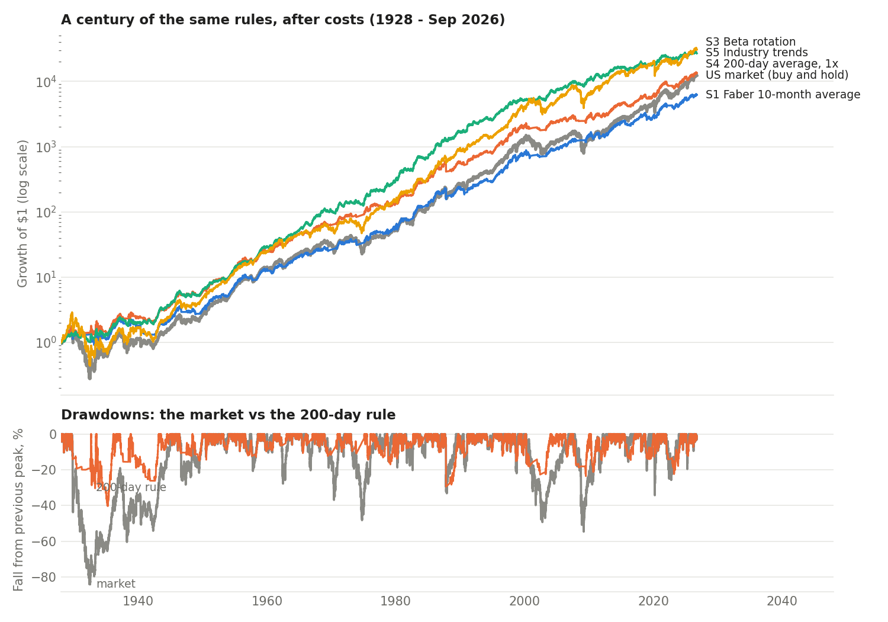
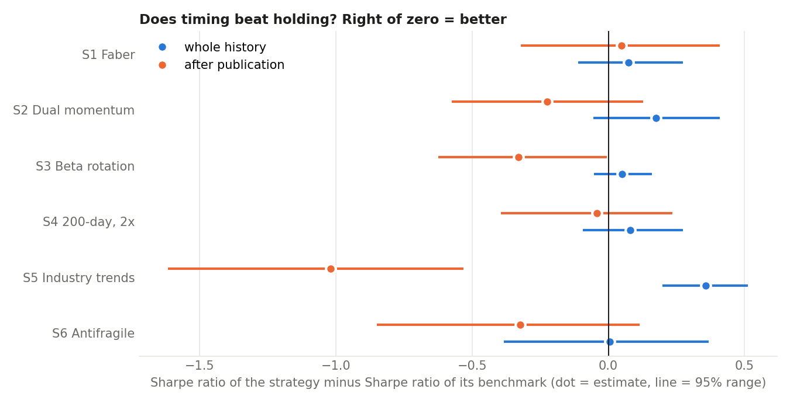
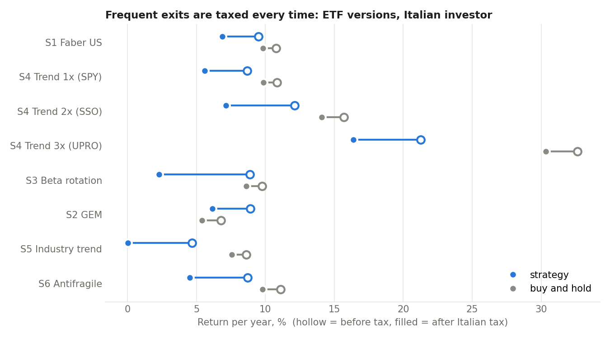

# Do popular market-timing strategies still work?

A pre-registered test of six published strategies for individual investors, and of what is left
for a European (Italian) investor after real products and taxes.

## Question and answer

Six well-known papers propose simple rules for stepping in and out of the stock market. Each
claims to beat buying and holding, mostly by avoiding large crashes. This study tests all six the
same way: same data, same trading costs, same return on idle cash, and each paper's own rules,
with nothing tuned.

**Answer.**
- **Crashes:** every strategy cut the worst losses, by a lot. In 1929–32 the US market fell 84%;
  a 200-day moving-average rule lost 19%.
- **Risk-adjusted return:** over the full history, only one strategy (Industry Trends) beat the
  market by more than luck can explain.
- **After publication:** no strategy beat its benchmark after its paper came out.
- **For an Italian investor using ETFs:** taxes on every profitable exit erased most of what was
  left.



## Terms used

| Term | Meaning |
|---|---|
| **Return per year** (CAGR) | Compound annual growth rate: the constant yearly return that turns the starting money into the final money. |
| **Volatility** | How much returns swing, as an annualised standard deviation. |
| **Sharpe ratio** | Return above the T-bill rate, divided by volatility: return per unit of risk. Higher is better; the US market has been around 0.45 over a century. |
| **Maximum drawdown** | The largest fall from a previous peak, e.g. −84% for US stocks in 1929–32. |
| **T-bill** | One-month US government bill: the "cash" return. |
| **Pre-registration** | Writing the rules down *before* running any test, so the results cannot steer the method. |
| **ETF / UCITS / ETP** | An ETF is an exchange-traded fund. UCITS is the EU standard that funds sold to EU individuals must meet. An ETP (exchange-traded product, e.g. a leveraged note or a gold ETC) is a debt security of its issuer, not a fund. |
| **2× / 3× leverage** | A product that returns 2 or 3 times the index's daily move, reset every day. |

## The six strategies

| # | Paper | Rule in one line |
|---|---|---|
| S1 | Faber (2007, updated 2013) | Hold stocks when the month-end price is above its 10-month average, otherwise cash. |
| S2 | Antonacci, *Dual Momentum* (2012) | Each month, hold whichever of US or non-US stocks rose more over 12 months; if neither beat T-bills, hold bonds. |
| S3 | Gayed & Bilello, *Beta Rotation* (2014) | Each week, hold utilities if they beat the market over 4 weeks, otherwise the market. |
| S4 | Gayed & Bilello, *Leverage for the Long Run* (2016) | Hold stocks (1×, 2× or 3×) when the index is above its 200-day average, otherwise cash. |
| S5 | Zarattini & Antonacci, *A Century of Profitable Industry Trends* (2025) | Buy each of 48 US industries on a breakout to a new high, exit on a trailing stop, size by volatility. |
| S6 | Giordano, *Antifragile Asset Allocation* (2019) | Each month, rank 11 sector ETFs on momentum, volatility, correlation and trend; hold the top 5, put the rest in "hedge" assets. |

## How it was tested

- **Rules first.** [`PROTOCOL.md`](PROTOCOL.md) was written and fixed before any code (the private
  development history keeps the timestamps). Choices made later
  are logged in its changelog, each marked as made before or after results were seen.
- **Replication first.** Before any comparison, the code reproduced each paper's published
  numbers from the same data ([`results/REPLICATION.md`](results/REPLICATION.md)):
  - both Gayed papers to four decimals;
  - Industry Trends and Faber closely;
  - Dual Momentum approximately, because MSCI and bond-index data are not free.
- **Three data tiers.**
  - *Century:* Kenneth French data library, US stocks and 48 industries, July 1926 →.
  - *Half century:* French international index and FRED bond yields, 1975 →.
  - *ETFs:* real funds, each from its launch (1993 for SPY, 2009–2010 for the 3× funds).
  - Everything ends on 30 September 2026.
- **Same test bench for everyone.**
  - A signal read at a close is traded at the *next* day's close (an investor can't trade on a
    price they haven't seen).
  - Each trade costs 0.05% (0.10% for leveraged products).
  - Idle cash earns the T-bill rate minus 0.15% a year (a money-market fund's fee).
  - Leverage before leveraged ETFs existed is simulated, and checked against the real 2× and 3×
    ETFs (SSO, UPRO): daily correlation above 0.99, and 0.6–1.2 points a year below the real
    funds' return, so slightly conservative.
- **Statistics.**
  - **Two main tests per strategy:** the full history, and the period after publication.
  - **Uncertainty:** a paired block bootstrap, which resamples whole years of strategy and
    benchmark returns together 5,000 times.
  - **Testing many things at once:** p-values are corrected with Holm's method, because running
    12 tests makes some lucky "wins" likely.

## Results



| Strategy (data) | Period | Return / yr | Sharpe | Max drawdown | Benchmark: Sharpe, drawdown |
|---|---|--:|--:|--:|--:|
| S1 Faber (US stocks) | 1927–2026 | 9.4% | 0.53 | −48% | market 0.45, −84% |
| | after 2006 | 9.1% | 0.61 | −22% | 0.56, −55% |
| S2 Dual momentum | 1976–2025 | 13.8% | 0.74 | −27% | 60/40 mix 0.57, −32% |
| | after 2012 | 7.3% | 0.51 | −27% | 0.73, −20% |
| S3 Beta rotation | 1926–2026 | 11.2% | 0.51 | −85% | market 0.46, −84% |
| | after 2014 | 6.9% | 0.37 | −42% | 0.70, −34% |
| S4 200-day rule, 1× | 1927–2026 | 10.3% | 0.62 | −40% | market 0.45, −84% |
| S4 200-day rule, 2× | 1927–2026 | 14.0% | 0.54 | −69% | constant 2×: 0.40, −98% |
| | after 2016 | 17.3% | 0.69 | −43% | market 0.73 |
| S5 Industry trends | 1926–2026 | 11.2% | **0.82** | −31% | market 0.46, −84% |
| | after Apr 2024 | 2.1% | −0.21 | −13% | 0.81, −20% |
| S6 Antifragile (ETFs) | 2004–2026 | 8.7% | 0.57 | −22% | SPY 0.56, −55% |
| | after 2019 | 7.2% | 0.39 | −17% | 0.72, −34% |

The 2× rule is tested against the plain market, as in its paper.

**Main tests:** only S5 over its full history passes after the correction for multiple tests
(p ≈ 0.00). Every other p-value is 0.84 or higher. All tests: [`results/primary_tests.csv`](results/primary_tests.csv).

**What the numbers say**
1. **The protection is real.** The table below shows returns during each crash.
2. **The extra return mostly isn't.** Over a century, S1, S3 and S4 improve the Sharpe ratio by
   0.05–0.17. In their main tests that is an amount luck could produce: the 95% ranges include
   zero. They give up return in
   long bull markets, and after 2014 that cost dominated.
3. **Industry Trends is the exception, until it meets reality.**
   - Its century-long edge is large and statistically clear.
   - It rebalances every day. On the 31 real sector ETFs, with costs, its Sharpe is 0.32 against
     the S&P 500's 0.42 (1999–2026). With the paper's own cost assumption it reproduces the
     paper (0.61 vs 0.59, 2005–2024), so the gap is trading costs.
   - After publication: 2.5 years, too short to judge.
4. **Leverage magnifies both sides.** The 3× version of the 200-day rule returned 17.3% a year
   over a century, but its worst fall was −86%. On the real 3× ETF since 2009 it returned 21.7%
   a year, against 32.6% for simply holding it.
5. **Antifragile depends on unpublished choices.** The paper does not publish its ranking
   weights. Across all 1,771 weight combinations the Sharpe ratio ranges from 0.41 to 0.72, with
   a median of 0.57, the same as the S&P 500 (0.56). A variant adding 3× funds (UPRO, TQQQ, EDC)
   did worse: 0.35 vs 0.77 since 2010.

### Returns during crashes (century data)

| Crash | US market | S1 Faber | S4 1× | S4 2× | Constant 2× | S5 Industry trends |
|---|--:|--:|--:|--:|--:|--:|
| 1929–32 Great Depression | −84% | −24% | −19% | −39% | −98% | −28% |
| 1973–74 oil shock | −48% | −13% | −4% | −20% | −78% | −10% |
| 1987 crash | −33% | −24% | −28% | −52% | −59% | −10% |
| 2000–02 dot-com | −49% | −20% | −22% | −49% | −81% | −1% |
| 2007–09 financial crisis | −54% | −5% | −15% | −30% | −84% | −16% |
| 2020 Covid | −34% | −8% | −10% | −21% | −59% | −7% |

The 1987 crash happened in days, too fast for monthly or 200-day rules.
All eight crashes: [`results/crashes.csv`](results/crashes.csv).

### Sensitivity (century data, full history)

| Assumption changed | Effect on Sharpe ratio |
|---|---|
| Cash earns 0% instead of T-bills | −0.00 to −0.07 (strategies that sit in cash lose most) |
| Trade at the signal's own close (the papers' assumption) | +0.02 to +0.09 |
| Costs 0% instead of 0.05% | +0.01 to +0.11 |
| Costs 0.25% instead of 0.05% | −0.02 to −0.44; beta rotation and Industry Trends lose most |

All cases: [`results/sensitivities.csv`](results/sensitivities.csv).

## For a European investor

### Italian tax



**How the tax works** (simplified; not tax advice):
- **ETF gains** are taxed at 26% each time a position is sold at a profit. They cannot be
  offset by earlier losses: ETF gains are "redditi di capitale", losses are "redditi diversi".
- **ETP and ETC gains** (leveraged notes, gold) can be offset by losses from the previous 4 years.
- **Government-bond ETFs** are taxed at 12.5%.
- **Buy-and-hold** pays tax only once, when sold at the end.

**Result:** a strategy that exits often pays tax often, and never gets its losses back against
ETF gains. After tax:

| Strategy | Before tax | After tax | Buy and hold after tax |
|---|--:|--:|--:|
| S3 Beta rotation | 8.9% | 2.3% | 8.6% |
| S5 Industry trends | 4.7% | 0.0% | 7.6% |
| S6 Antifragile | 8.7% | 4.5% | 9.8% |
| S2 Dual momentum | 8.9% | 6.1% | 5.4% (60/40 mix) |

Dual momentum is the only strategy still ahead of its benchmark after tax. All rows:
[`results/tax.csv`](results/tax.csv).

### Products available to EU individuals (examples, Nov 2026)

US-listed ETFs cannot be bought by EU individuals. Each one needs a UCITS fund or an ETP
equivalent.

| Needed for | US fund in the backtest | EU-available example | Type |
|---|---|---|---|
| S&P 500 | SPY | iShares Core S&P 500 (CSPX) | UCITS ETF |
| 2× S&P 500 | SSO | Xtrackers S&P 500 2x Leveraged Daily Swap | UCITS ETF |
| 3× S&P 500 / Nasdaq-100 | UPRO / TQQQ | WisdomTree S&P 500 3x (3USL) / Nasdaq-100 3x (QQQ3) | ETP |
| 3× emerging markets | EDC | WisdomTree Emerging Markets 3x (3EML) | ETP |
| US sectors (11) | XLU, XLP, … | SPDR S&P U.S. Select Sector UCITS ETFs (e.g. ZPDU, ZPDS) | UCITS ETF |
| Cash at the overnight rate | BIL | Xtrackers USD Overnight Rate Swap (XFFE / DXSZ) | UCITS ETF |
| Gold | GLD | physical gold ETCs | ETP |

**What can't be replicated in the EU:**
- S5's 31 industry ETFs (only about 11 US sectors exist as UCITS);
- the yen and franc funds in S6 (only as currency ETPs).

Tickers vary by exchange: check the ISIN with your broker.

### In euros

Converting the ETF results to euros without currency hedging (an appendix, from 1999) changes
the levels but not the conclusions. For example, Faber's US rule has a Sharpe of 0.47 vs 0.42
for the S&P 500. All rows: [`results/eur_appendix.csv`](results/eur_appendix.csv).

## Limitations

- The century data covers all US stocks, not the S&P 500, and is not investable as such.
  Industry portfolios had no real counterpart before about 1999.
- Trading costs before 1990 were higher than 0.05%; the 0.25% sensitivity shows the effect.
- Dual momentum uses substitute data (French international index, a bond computed from
  Treasury yields), not MSCI and Barclays indices.
- The tax model is simplified:
  - all funds are treated as accumulating (no dividend distributions);
  - idle cash is a money-market ETF, taxed when sold;
  - the 12.5% rate applies only to pure Treasury ETFs;
  - no account-level tax planning.
- Post-publication periods are short: Industry Trends has 2.5 years.

## Reproduce

```bash
pip install -r requirements.txt
python src/data.py            # downloads French library and FRED files
python src/replicate.py       # replication of published numbers
python src/leverage_check.py  # synthetic vs real 2x/3x ETFs
python src/bench.py           # main comparison (~10 min, Antifragile GARCH fits are cached)
python src/extras.py          # crashes, Italian tax, euro appendix
python src/charts.py          # figures
```

Market data is downloaded, not committed (provider terms). ETF prices come from Yahoo Finance.

## References

- Antonacci, G. (2012, rev. 2016). Risk Premia Harvesting Through Dual Momentum. SSRN 2042750.
- Bailey, D. H., & López de Prado, M. (2014). The deflated Sharpe ratio. *Journal of Portfolio Management*, 40(5), 94–107.
- Faber, M. T. (2007, updated 2013). A Quantitative Approach to Tactical Asset Allocation. *Journal of Wealth Management*; SSRN 962461.
- French, K. R. Data Library. https://mba.tuck.dartmouth.edu/pages/faculty/ken.french/data_library.html
- Gayed, M. A., & Bilello, C. (2014; revision 2026). An Intermarket Approach to Beta Rotation. SSRN 2417974.
- Gayed, M. A., & Bilello, C. (2016; revision 2026). Leverage for the Long Run. SSRN 2741701.
- Giordano, G. (2019). Antifragile Asset Allocation Model. Italian Society of Technical Analysis.
- Holm, S. (1979). A simple sequentially rejective multiple test procedure. *Scandinavian Journal of Statistics*, 6(2), 65–70.
- Keller, W. J., & van Putten, H. S. (2012). Generalized Momentum and Flexible Asset Allocation (FAA). SSRN 2193735.
- McLean, R. D., & Pontiff, J. (2016). Does academic research destroy stock return predictability? *Journal of Finance*, 71(1), 5–32.
- Politis, D. N., & Romano, J. P. (1992). A circular block-resampling procedure for stationary data. In *Exploring the Limits of Bootstrap*, Wiley.
- Zarattini, C., & Antonacci, G. (2025). A Century of Profitable Industry Trends. Concretum Research.

## License

Code under the MIT License ([LICENSE](LICENSE)). Market data is not included and stays subject to
each provider's terms.
